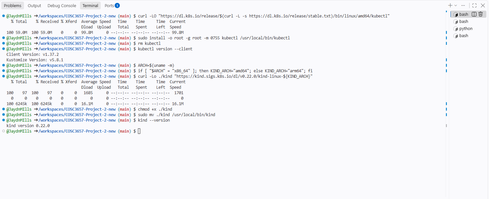
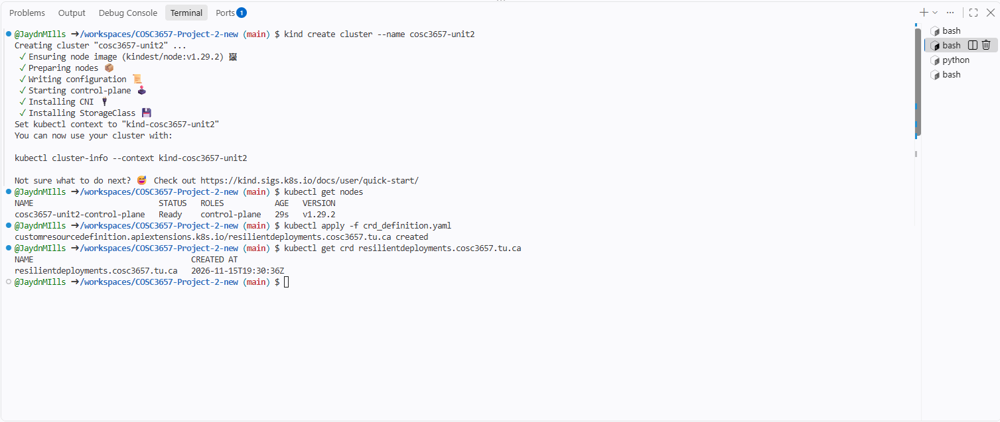
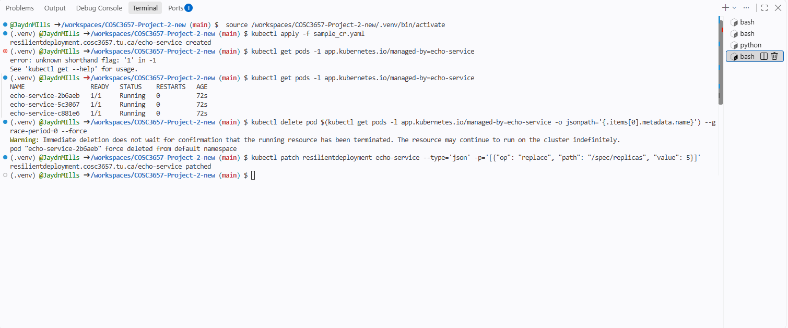
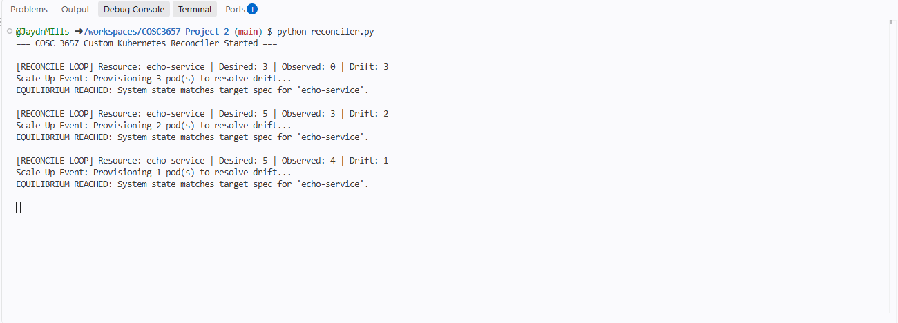

# Unit 2: Declarative Infrastructure & Mini-K8s Reconciliation

**Course:** COSC 3657 (Distributed Systems)  
**Student:** Jaydn Mills

## Project Overview
This repository contains the implementation of a declarative, self-healing control plane for a Mini-Kubernetes cluster. Transitioning from imperative execution models, this project uses a custom Python-based Reconciliation Controller (`reconciler.py`) and a Custom Resource Definition (CRD) to maintain system equilibrium under partial node failures (Crash-Stop Failure Model). The controller actively observes cluster state, computes drift against user-declared specifications, and executes idempotent API operations.

## Repository Structure
*   `crd_definition.yaml`: Kubernetes Custom Resource Definition schema defining the `ResilientDeployment` domain abstraction.
*   `sample_cr.yaml`: Custom Resource declarative intent manifest.
*   `reconciler.py`: Active, event-driven Python Reconciliation Controller.
*   `README.md`: Project documentation and execution evidence.

---

## Execution Steps & Verification Evidence

### 1. Environment Setup & Tooling Installation
Because the native GitHub Codespaces environment did not include the required cluster tooling out of the box, the first step involved fetching architecture-aware binaries for `kind` and `kubectl` and configuring them for the system path.

  
*Screenshot showing the terminal commands used to successfully install `kubectl` and `kind` within the Codespaces environment.*

### 2. Cluster Provisioning
With the tooling installed, a local Kubernetes environment was provisioned to serve as the control plane and worker nodes for the reconciliation loop.

  
*Screenshot demonstrating the successful creation and initialization of the `cosc3657-unit2` kind cluster.*

### 3. Applying Declarative Manifests
The Custom Resource Definition was applied to teach the API server the `ResilientDeployment` schema, followed by the sample manifest to establish the desired state. 

  
*Screenshot showing the application of the YAML files and the use of verification commands (`kubectl get crd`, etc.) to confirm the cluster recognized the new resources.*

### 4. Continuous Reconciliation & Fault Recovery
The Python controller was launched to stream API events asynchronously. It successfully computed state drift, provisioned the initial target replica count, adapted to a mutated desired state (scale-up), and instantly healed the system when a crash-stop failure was simulated via forced pod eviction.

  
*Screenshot of the `reconciler.py` terminal output, verifying the controller's logic: identifying drift, reaching initial equilibrium, processing a scale mutation, and executing a self-healing replacement upon pod deletion.*

---

## Deliverables Checklist
- [x] Create your own Mini-K8s cluster and apply the provided custom resource definition `crd_definition.yaml`.
- [x] Complete implementation of `reconciler.py` so it can handle watch events, calculating drift, and performing idempotent scale operations.
- [x] Terminal screenshot/log recording demonstrating that forcibly deleting a pod via `kubectl delete pod --force` causes the reconciler to automatically provision a replacement pod.
- [x] Record the presentation of your code, also explain what challenges encountered and overcomed.
- [x] Submit your github repository with the completed code.
